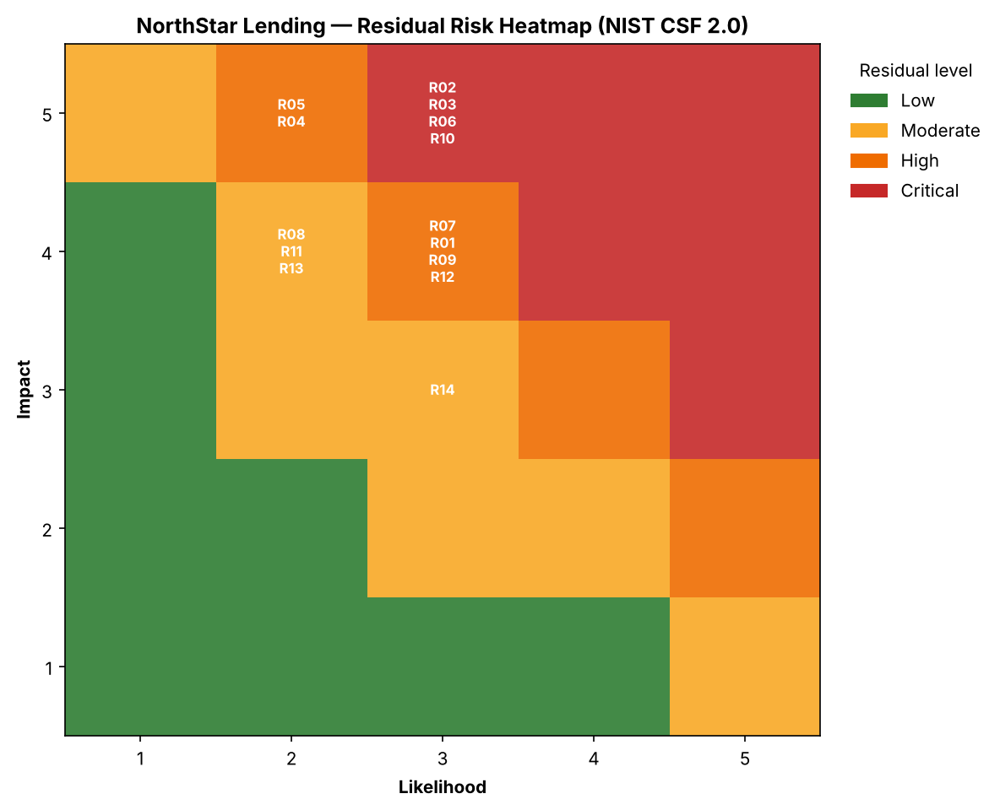

# Information Security Risk Assessment — Fintech (NIST CSF 2.0)

A complete, reproducible **information security risk assessment** for a fictional
financial-services company, built the way a GRC analyst would deliver it: a scoped
scenario, a documented methodology, a quantitative risk register, a Python scoring
engine, and a findings report with a prioritized remediation roadmap.

> **This is a portfolio / lab project.** *NorthStar Lending, Inc.* is fictional and
> all data is invented. The goal is to demonstrate GRC methodology, not to describe
> any real company.

---

## What this project demonstrates

| GRC skill | Where to see it |
|-----------|-----------------|
| Risk assessment methodology (NIST SP 800-30) | [`docs/02-risk-assessment-methodology.md`](docs/02-risk-assessment-methodology.md) |
| Risk register design & scoring (inherent vs. residual) | [`data/risk-register.csv`](data/risk-register.csv) |
| NIST CSF 2.0 mapping across all six functions | report §4 |
| Quantitative risk (SLE / ARO / ALE) — the finance view | methodology §4, report §3 |
| Regulatory grounding (GLBA Safeguards Rule, SOC 2, PCI) | [`docs/01-company-scenario.md`](docs/01-company-scenario.md) |
| Automation & data viz (Python) | [`scripts/risk_scoring.py`](scripts/risk_scoring.py) |
| Findings reporting & remediation roadmap | [`docs/03-risk-assessment-report.md`](docs/03-risk-assessment-report.md) |

## Results at a glance

14 risks assessed against NIST CSF 2.0. Residual exposure after existing controls:

| Critical | High | Moderate | Low |
|----------|------|----------|-----|
| 4 | 6 | 4 | 0 |



## Deliverables

- [`Risk-Assessment-Report.docx`](Risk-Assessment-Report.docx): full risk assessment report (Word)
- [`Risk-Assessment-NIST-CSF.xlsx`](Risk-Assessment-NIST-CSF.xlsx): risk register workbook (Excel)

## Repository structure

```
grc-risk-assessment-fintech/
├── README.md                     ← you are here
├── docs/
│   ├── 01-company-scenario.md    ← fictional company, scope, data, compliance drivers
│   ├── 02-risk-assessment-methodology.md   ← scoring model + quantitative layer
│   └── 03-risk-assessment-report.md        ← findings, top risks, remediation roadmap
├── data/
│   └── risk-register.csv         ← the 14-risk register (source of truth)
├── scripts/
│   ├── risk_scoring.py           ← scores risks, bands them, builds the heatmap
│   └── requirements.txt
└── outputs/                      ← generated by the script
    ├── risk-register-scored.csv
    ├── risk-heatmap.png
    └── risk-summary.md
```

## How to run

```bash
pip install -r scripts/requirements.txt
python3 scripts/risk_scoring.py
```

This reads `data/risk-register.csv`, computes inherent and residual scores
(`Likelihood × Impact`, 1–5 scales), bands each into Low/Moderate/High/Critical,
and regenerates everything in `outputs/`.

## Methodology in one paragraph

Each risk is scored for **inherent** exposure (before controls) and **residual**
exposure (after existing controls), so the register shows both raw risk and what
current controls buy down. Residual risk drives the treatment decision. For the
highest risks, a **quantitative annualized-loss** estimate (SLE × ARO = ALE)
translates the risk into dollars, so a control's cost can be weighed against the
risk it removes — the expected-value logic that gets security work funded. Full
details in [`docs/02-risk-assessment-methodology.md`](docs/02-risk-assessment-methodology.md).

## Standards referenced

NIST CSF 2.0 · NIST SP 800-30 · FTC Safeguards Rule (GLBA, 16 CFR 314) ·
NIST SP 800-53 Rev. 5 · CIS Controls v8

---

*Part of a three-project GRC portfolio. Next: a multi-framework controls crosswalk
(NIST CSF ⇄ 800-53 ⇄ ISO 27001 ⇄ CIS).*
